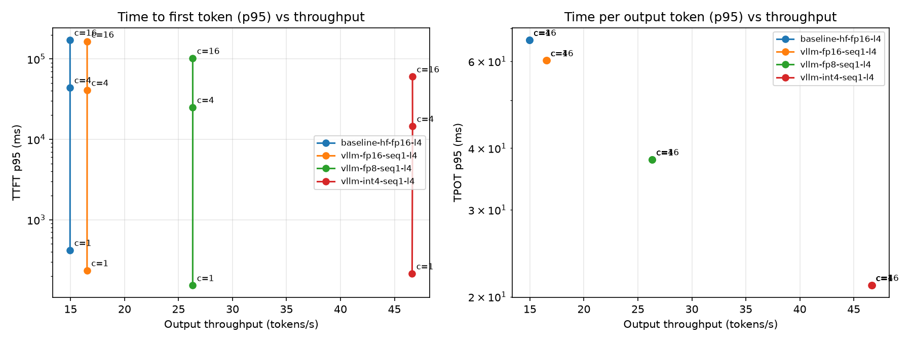

# TokenForge

A self-hosted, OpenAI-compatible LLM inference platform, built layer by layer
from a deliberately naive baseline to an optimized, autoscaled Kubernetes
deployment. Every layer is benchmarked against the one before it, so each
optimization comes with a measured before/after number.

**Model:** Qwen3-8B  **Hardware:** NVIDIA L4 (24 GB)  **Status:** Phase 0 complete, Phase 1 in progress

---

## Results

All runs use the same fixed workload (`bench/workloads/chat.jsonl`), the same
harness, and the same GPU, so rows are directly comparable.

| Phase | Configuration | Out tok/s @ c=16 | TTFT p95 @ c=16 | TPOT p50 @ c=1 | $ / 1M output tokens |
| --- | --- | --- | --- | --- | --- |
| 0 | Hugging Face `transformers`, FP16, one request at a time | 14.9 | 172,658 ms | 65.6 ms | $13.01 |
| 1 | Quantization (FP8 / INT4) | | | | |
| 2 | vLLM: continuous batching, prefix caching | | | | |
| 6 | Kubernetes, cache-aware routing, autoscaling | | | | |

*c = concurrent requests. TTFT = time to first token. TPOT = time per output token.*



Better configurations sit further **right** (more throughput) and **lower**
(less latency). The y-axis is logarithmic.

---

## Phase 0 findings: the naive baseline

The baseline serves the model with plain Hugging Face `transformers`, one
request at a time behind a lock. It is slow on purpose: it is the "before"
measurement for everything else.

**1. Concurrency added zero capacity.** Throughput was 14.95 tok/s at
concurrency 1, 4 and 16. Extra users only waited in line.

**2. Queueing fully explains the latency.** Each request took ~10.5 s on
average. At concurrency 4 a request waits behind ~3 others, so predicted TTFT
≈ 31.5 s; measured p50 was 31.3 s. At concurrency 16, p95 TTFT reached 173 s.

**3. Decode is memory-bandwidth-bound.** Generating each token reads every
transformer-block weight plus the `lm_head`, about 15.2 GB (the 1.2 GB
embedding table is a single-row lookup, not a full read). At the L4's
~300 GB/s, the ceiling is ~51 ms per token. Measured TPOT was 65.6 ms, about
77% of the hardware limit. Per-token speed is decent; serving one request at
a time is the problem.

**4. Prefill is ~200x cheaper per token than decode.** TTFT at concurrency 1
grew as ~160 ms + 0.31 ms per prompt token, about 3,200 prompt tokens/s,
versus 15 tok/s for generation. Prefill processes the whole prompt in one
pass over the weights; decode re-reads them for every token.

**5. Goodput collapsed even though throughput didn't move.** Requests meeting
the SLO (TTFT < 1 s, TPOT < 100 ms) fell from 0.095/s to 0.003/s. Only the
first request at each level, which never waited, met it.

**What this sets up:** finding 3 says shrinking the weights should speed up
decode (Phase 1, quantization). Finding 1 says batching requests so one read
of the weights serves many users should multiply throughput (Phase 2, vLLM).

Full write-up: [docs/phase-0-baseline.md](docs/phase-0-baseline.md)

---

## Phase 1 findings (in progress): profiling one request

Before optimizing, `optimize/model_math.py` predicts memory use and decode
ceilings from the model config, and `optimize/profile_request.py` runs
prefill and decode by hand under the PyTorch profiler to see where GPU time
actually goes.

**Model math predictions (Qwen3-8B on L4, 512-token context):**

| Weights | Weight memory | KV cache room | Min time per token | Max tok/s |
| --- | --- | --- | --- | --- |
| FP16 | 16.4 GB | ~36k tokens | 50.7 ms | ~20 |
| FP8 | 9.4 GB | ~84k tokens | 27.6 ms | ~36 |
| INT4 | 6.0 GB | ~107k tokens | 16.0 ms | ~63 |

KV cache: 144 KB per token (36 layers × 8 KV heads × 128 dims × K and V × 2 bytes).
Grouped-query attention (8 KV heads for 32 query heads) makes it 4x smaller.

**Where one decode step's time goes** (HF FP16, from the profiler trace):

| | 512-token prompt | 2048-token prompt |
| --- | --- | --- |
| Total step time | 67.5 ms | 68.3 ms |
| Matrix multiplications | 58.8 ms (87%) | 59.0 ms (86%) |
| Other small kernels | 4.6 ms (7%) | 6.3 ms (9%) |
| GPU idle (gaps) | 3.4 ms (5%) | 3.0 ms (4%) |
| Kernels launched per step | 2,074 | 2,074 |
| Model-math ceiling | 50.7 ms | 55.0 ms |

**1. Kernel launch gaps are small:** only ~5% of the step is GPU idle time, so CUDA graphs can recover at most that.

**2. The matmuls already run near the practical limit:** ~257 GB/s, 86% of the L4's 300 GB/s spec.

**3. Decode is memory-bound:** the 253 `gemv` kernels split their time 79/21 between MLP + `lm_head` and attention, matching their 80/20 split in bytes.

**4. Hugging Face copies the whole KV cache every step:** 72 `torch.cat` kernels per step, rising from 2.2% to 4.1% of the step from 512 to 2048 tokens of context. PagedAttention avoids this.

**5. Prefill is compute-bound but reaches only about a third of peak:** ~40–43 TFLOPS against ~120, with unfused elementwise ops at 9–17% of prefill time.

**What this means for the rest of Phase 1:** at one request at a time, the HF
baseline is already near the practical bandwidth limit, so a better engine
alone should give only a modest per-token gain. The large levers are reading
fewer bytes (quantization, next) and serving many requests per read of the
weights (batching, Phase 2).

Full write-up (in progress): [docs/phase-1-optimization.md](docs/phase-1-optimization.md)

---

## Roadmap

- [x] **Phase 0: Baseline.** Naive HF server and benchmark harness
- [ ] **Phase 1: Model optimization.**
    - [x] Model math: memory, KV cache, and decode ceilings per precision
    - [x] Profiling: prefill vs decode, kernel breakdown
    - [x] FP8 and INT4 quantization
    - [ ] Quality evals (perplexity, task accuracy)
    - [ ] Speed benchmarks: FP16 vs FP8 vs INT4
    - [ ] FP8 KV cache and speculative decoding
- [ ] **Phase 2: Inference engine.** vLLM tuning (continuous batching, prefix caching, chunked prefill), comparison with SGLang
- [ ] **Phase 3: Gateway.** API keys, per-key rate limiting (Redis), streaming proxy
- [ ] **Phase 4: Containers.** Multi-stage Docker images, docker-compose stack
- [ ] **Phase 5: Kubernetes.** Helm chart, GPU scheduling, probes, rolling updates
- [ ] **Phase 6: Routing and autoscaling.** KV-cache-aware routing, KEDA autoscaling on queue depth
- [ ] **Phase 7: Observability and CI.** Grafana dashboards, tracing, benchmark regression gate in CI

---

## Repository layout

```
TokenForge/
├── baseline/
│   └── server.py           # Phase 0: naive HF server (frozen; it's the "before")
├── bench/
│   ├── make_workloads.py   # generates the fixed, seeded workloads
│   ├── loadgen.py          # async load generator: TTFT, TPOT, goodput, $/1M tokens
│   ├── plot.py             # latency vs throughput chart
│   ├── workloads/          # committed once, never edited
│   └── results/            # one JSON per run, with full metadata
├── optimize/
│   ├── model_math.py       # predicts memory, KV cache size, decode ceilings
│   └── profile_request.py  # profiles prefill and decode, exports a GPU trace
├── docs/                   # one write-up per phase
├── requirements.txt        # all Python dependencies except quantization
└── requirements-quantize.txt  # llmcompressor, in its own venv (conflicts with vLLM)
```

---

## Quickstart

```bash
git clone https://github.com/YOUR-USERNAME/TokenForge.git
cd TokenForge
python3 -m venv venv && source venv/bin/activate
pip install -r requirements.txt
```

**Run the baseline server.** Use a small model on a laptop, or Qwen3-8B on a 24 GB GPU:

```bash
MODEL_ID=Qwen/Qwen3-0.6B uvicorn baseline.server:app --port 8000
```

**Send a request.** The API is OpenAI-compatible, so any OpenAI client works:

```bash
curl localhost:8000/v1/chat/completions \
  -H 'Content-Type: application/json' \
  -d '{"messages":[{"role":"user","content":"Explain a KV cache in one sentence."}],"max_tokens":64}'
```

**Benchmark it** (in a second terminal):

```bash
python bench/loadgen.py --workload bench/workloads/chat.jsonl \
  --concurrency 1 4 16 --num-requests 32 --ignore-eos --max-tokens-cap 256 \
  --gpu-cost-per-hour 0.70 --label my-run
python bench/plot.py bench/results/*.json
```

---

## Benchmark methodology

**Workloads.** Three fixed JSONL files generated once from a fixed seed
(`make_workloads.py --seed 42`) and committed:

| Workload | Shape | Stresses |
| --- | --- | --- |
| `chat` | Log-normal input and output lengths (median ~150 words in, ~200 tokens out) | General serving |
| `shared_prefix` | Same ~2k-token system prompt + short question | Prefix caching, cache-aware routing |
| `long_context` | ~8k-token input, 128-token output | Prefill, KV cache memory |

**Load.** Closed-loop: *c* virtual users, each sending its next request as
soon as the previous one finishes. Each concurrency level sends the same 32
requests (shuffled with a fixed seed) after 2 warmup requests.

**Settings for all reported runs.** `temperature=0`, `ignore_eos=true`
(every request generates exactly its `max_tokens`), `max_tokens` capped at
256, streaming with server-reported token counts (`stream_options.include_usage`).

**Metrics.**

| Metric | Definition |
| --- | --- |
| TTFT | Request sent → first content token received (queueing + prefill) |
| TPOT | (end-to-end − TTFT) ÷ (output tokens − 1) (decode speed) |
| Output throughput | Total output tokens ÷ wall-clock time for the level |
| Goodput | Requests per second meeting the SLO: TTFT < 1,000 ms and TPOT < 100 ms |
| $ / 1M output tokens | GPU $/hour ÷ output tokens per hour × 1,000,000 |

Latencies are reported as percentiles (p50, p95, p99), not averages.

**Environment for reported results.** NVIDIA L4 (23 GB usable), driver
595.91.07, RunPod at $0.70/hour, Python 3.12, server and load generator on
the same machine (no network latency included). Every result file in
`bench/results/` records its full configuration, git commit and hardware.