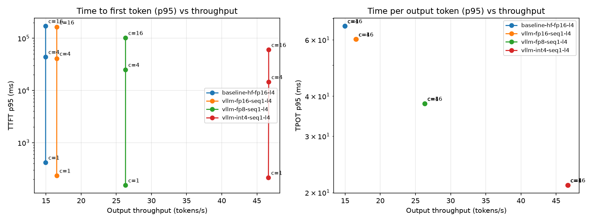

# Phase 0: The naive baseline

**Goal:** serve Qwen3-8B the obvious way, measure it carefully, and get a
"before" number that every later optimization has to beat.

**Result:** 14.95 output tokens/s no matter how many users, $13.01 per 1M
output tokens, and p95 time to first token of 173 s at 16 concurrent users.

---

## What I built

### The server: `baseline/server.py`

A FastAPI app that loads Qwen3-8B with Hugging Face `transformers` in FP16
and exposes an OpenAI-compatible `/v1/chat/completions` endpoint (plus
`/health`).

- **One request at a time.** Every call to `generate()` runs behind a single
  `threading.Lock` (`GPU_LOCK`). This is the naive design on purpose: it's how
  you'd serve a model if you just wrapped `generate()` in a web endpoint.
- **Streaming over SSE.** `TextIteratorStreamer` runs `generate()` in a
  background thread and yields text as it's produced, so the client can
  measure time to first token.
- **Benchmark hooks.** Two small additions make the measurements exact:
  - `ignore_eos`, implemented as `min_new_tokens = max_tokens`, so every
    request generates exactly the number of tokens the workload asks for.
    Without it, output lengths would depend on the model's choices, and
    throughput numbers would not be comparable across runs or engines.
  - `stream_options.include_usage` sends a final chunk with exact prompt and
    completion token counts, so the load generator doesn't have to guess
    token counts from text.
- **Thinking disabled.** Qwen3 defaults to a "thinking" mode that emits a
  reasoning block first. `enable_thinking=False` in the chat template keeps
  output lengths under the workload's control.

This file is now frozen. It is the "before" picture and won't be optimized.

### The benchmark harness: `bench/`

I built the harness before optimizing anything, because without it every
later phase would just be "I installed a tool."

- **`make_workloads.py`** generates three fixed workloads from seed 42 (a
  separate RNG for each, so changing one doesn't shift the others):
  - `chat`: 500 requests, log-normal lengths, about 150 words in and 200 tokens out
  - `shared_prefix`: 200 requests that share a ~2k-token system prompt
  - `long_context`: 50 requests with ~8k tokens in and 128 out

  The files are committed and never edited. A changed workload gets a new
  `_v2` file, so old results stay comparable.
- **`loadgen.py`** is an async `httpx` client that always streams. It runs a
  closed-loop load: *c* virtual users, each sending its next request as soon
  as the last one finishes. Every concurrency level sends the same 32
  requests (shuffled with a fixed seed) after 2 warmup requests. It records
  TTFT, TPOT, end-to-end latency, output throughput, goodput and cost, and
  saves one JSON per run with the arguments, `/health` output, git commit and
  GPU info, plus every individual request.
- **`plot.py`** draws p95 TTFT and p95 TPOT against output throughput, one
  line per result file, with a log-scale y-axis.

**Metric definitions** (the same as vLLM's own benchmark, so I can cross-check
later):

| Metric | Definition |
| --- | --- |
| TTFT | Request sent → first content token received (queueing + prefill) |
| TPOT | (end-to-end − TTFT) ÷ (output tokens − 1) |
| Output throughput | Total output tokens ÷ wall-clock time for the level |
| Goodput | Requests/s that meet the SLO: TTFT < 1,000 ms **and** TPOT < 100 ms |
| $ / 1M output tokens | GPU $/hour ÷ output tokens per hour × 1,000,000 |

---

## Setup

| | |
| --- | --- |
| Model | Qwen/Qwen3-8B, FP16 |
| GPU | NVIDIA L4, 23,034 MiB, driver 595.91.07 |
| Provider | RunPod on-demand, $0.70/hour |
| Software | Python 3.12.3, commit `8212420` |
| Workload | `bench/workloads/chat.jsonl`, 32 requests per level, 2 warmup |
| Settings | `temperature=0`, `ignore_eos`, `max_tokens` capped at 256 |
| Client | Same machine as the server (no network latency) |

Command:

```bash
python bench/loadgen.py --workload bench/workloads/chat.jsonl \
  --concurrency 1 4 16 --num-requests 32 --ignore-eos --max-tokens-cap 256 \
  --gpu-cost-per-hour 0.70 --label baseline-hf-fp16-l4
```

Raw results: [`bench/results/baseline-hf-fp16-l4-chat-20261115-042900.json`](../bench/results/baseline-hf-fp16-l4-chat-20261115-042900.json)

---

## Results

Each level sent 32 requests: 9,440 input tokens and 5,028 output tokens in
total. All 96 requests succeeded.

| Concurrency | Out tok/s | TTFT p50 | TTFT p95 | TPOT p50 | E2E p50 | SLO met | Goodput (req/s) | $ / 1M out |
| --- | --- | --- | --- | --- | --- | --- | --- | --- |
| 1 | 14.95 | 225 ms | 419 ms | 65.6 ms | 9.3 s | 32/32 | 0.095 | $13.01 |
| 4 | 14.95 | 31,329 ms | 44,210 ms | 65.6 ms | 41.4 s | 1/32 | 0.003 | $13.01 |
| 16 | 14.95 | 147,344 ms | 172,658 ms | 65.6 ms | 159.5 s | 1/32 | 0.003 | $13.01 |



---

## Findings

**1. Concurrency added zero capacity.** Throughput was 14.95 tok/s at
concurrency 1, 4 and 16, and every level took the same ~336 s of wall time.
The lock means the GPU only ever works on one request, so extra users just
wait in line. TPOT didn't change either (65.6 ms at every level), because
once a request gets the GPU, it gets it alone.

**2. Queueing fully explains the latency.** An average request took about
10.5 s (336 s ÷ 32). At concurrency 4, a request waits behind ~3 others, so I
predicted TTFT ≈ 3 × 10.5 = 31.5 s. The measured p50 was 31.3 s. At
concurrency 16 the p95 TTFT reached 173 s. Almost all of that is waiting,
not computing.

**3. Decode is memory-bandwidth-bound.** To produce one token, the GPU must
read every transformer-block weight plus the `lm_head`, about 15.2 GB. (The
1.2 GB embedding table isn't read in full: each step looks up one row.) At
the L4's ~300 GB/s, that sets a floor of ~51 ms per token. Measured TPOT was
65.6 ms, about 77% of the hardware limit. Per-token speed is decent. Serving
one request at a time is the real problem.

**4. Prefill is ~200x cheaper per token than decode.** At concurrency 1,
TTFT grew as roughly 150 ms + 0.3 ms per prompt token, about 3,500 prompt
tokens/s, compared with 15 tok/s for generation. Prefill handles the whole
prompt in one pass over the weights, while decode re-reads all the weights
for every single token.

**5. Goodput collapsed while throughput stayed flat.** Requests meeting the
SLO fell from 0.095/s to 0.003/s. Only the first request at each level, which
never waited, met it. Throughput alone would make this server look fine at
concurrency 16. Goodput shows it's unusable.

---

## Known limitations of the measurement

- **The HF streamer emits whole words, not tokens.** `TextIteratorStreamer`
  holds text until it has a complete word, so stream chunks aren't tokens, and
  TTFT includes a little word buffering. Exact token counts come from the
  final usage chunk, so throughput and TPOT are unaffected.
- **One run per configuration.** The plan calls for 3 runs and the median.
  At 336 s per level with almost no variance (TPOT p50 to p99 spans 65.6 to
  66.9 ms), I accepted one run for the baseline.
- **Concurrency 32 and 64 were skipped.** With TTFT growing linearly with the
  queue, they would only take longer to show the same thing (~10.5 s per
  request ahead of you).

---

## What this sets up

- **Finding 3 → Phase 1 (quantization).** If decode time is set by bytes read,
  smaller weights should make each token faster.
- **Finding 1 → Phase 2 (vLLM).** If one read of the weights can serve many
  requests at once (batching), throughput should multiply instead of staying
  flat.
