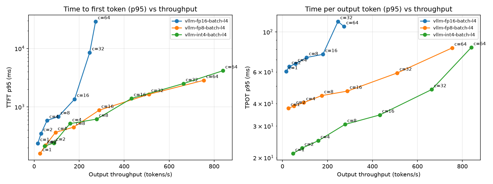

# Phase 2: Inference engine tuning

**Goal:** turn concurrency into throughput. Phase 1 made each token cheaper,
but every run there served one request at a time. Phase 2 lets vLLM batch
requests, then tunes the scheduler, turns on prefix caching, re-tests the
Phase 1 wins under load, and compares vLLM with SGLang.

**Approach:** same as before. Change one flag per run, and explain every
result from bytes, FLOPs and queueing.

**Summary** (Qwen3-8B INT4 on one L4, chat workload, concurrency 64 unless noted):

| Configuration | Out tok/s | TPOT p50 | TTFT p50 | SLO met (steady state) | $ / 1M tokens |
| --- | --- | --- | --- | --- | --- |
| HF FP16 baseline, c=16 (Phase 0) | 14.95 | 65.6 ms | 147,344 ms | | $13.01 |
| vLLM INT4, one at a time (Phase 1) | 46.6 | 20.8 ms | 80 ms | | $4.17 |
| vLLM INT4, continuous batching | 839 | 69.6 ms | 372 ms | 189/192 | $0.23 |
| + FP8 KV cache | **954** | 60.3 ms | 322 ms | 190/192 | **$0.20** |
| + EAGLE-3 (k=3) instead of FP8 KV | 780 | 72.8 ms | 675 ms | 177/192 | $0.25 |
| SGLang 0.5.23 INT4 | 823 | 69.8 ms | 297 ms | 163/192 | $0.24 |

On the shared-prefix workload (c=32), prefix caching took throughput from 175
to 800 tok/s and SLO attainment from 0% to 100%.

Overall: 64x the throughput and 65x lower cost per token than the Phase 0
baseline. Batching was the largest single lever. At c=64 the GPU stops being
memory-bound and becomes compute-bound, and that change explains most of
what follows.

| Piece | Status |
| --- | --- |
| 1. Continuous batching: FP16 vs FP8 vs INT4, c=1 to 64 | ✅ done |
| 2. Scheduler limits: `max-num-seqs`, `max-num-batched-tokens` | ✅ done |
| 3. Prefix caching on a shared system prompt | ✅ done |
| 4. Phase 1 wins under load: FP8 KV cache, EAGLE-3 | ✅ done |
| 5. SGLang comparison | ✅ done |

---

## Setup

- **Engine:** vLLM 0.34.0 with `--gpu-memory-utilization 0.85`, thinking off
  (`--default-chat-template-kwargs '{"enable_thinking": false}'`) and prefix
  caching off except in piece 3. Without a `--max-num-seqs` flag, vLLM can
  run up to 256 sequences at once.
- **Load:** `bench/loadgen.py` with `--min-rounds 4`. Each level sends at least
  4 requests per user (32 / 32 / 32 / 32 / 64 / 128 / 256 requests at
  c = 1 / 2 / 4 / 8 / 16 / 32 / 64), so every level reaches steady state
  instead of finishing during the first wave.
- **Runner:** piece 1 ran by hand (commit f9a74c7). Pieces 2–5 ran unattended
  with `bench/phase2.sh` (commit 0ff83a7). The script starts each server,
  benchmarks it, saves its `/metrics` counters and stops it. It took about
  95 minutes for about $1.10.
- **Reproducibility check:** the c=1 level of each batching run matches the
  Phase 1 one-at-a-time runs to within 1% (INT4 46.7 vs 46.6 tok/s, FP8
  26.5 vs 26.3, FP16 16.5 vs 16.5).

### Methodology note: the burst at the start of each level

The loadgen is closed-loop: c virtual users all send their first request at
the same moment, so each level starts with a burst of c prompts to prefill at
once. At c=64 that first wave is a quarter of the requests, and it dominates
the TTFT tail. For INT4 at c=64, **all 57 requests with TTFT over 1 s came
from the first wave.** The 192 requests after it had a TTFT p95 of 732 ms,
not 4,166 ms.

Real traffic doesn't arrive all in the same millisecond, so I report SLO
attainment both ways. "Steady state" excludes the first c requests of each
level. I computed it from the per-request records in the result files, with
the order rebuilt from loadgen's seeded shuffle. Throughput and TPOT p50
barely change either way. Only the TTFT tail and SLO attainment are affected.

| Steady state (after the first wave) | c=32 SLO | c=64 SLO | c=64 TTFT p95 | c=64 TPOT p95 |
| --- | --- | --- | --- | --- |
| vLLM INT4 | 96/96 | 189/192 | 732 ms | 79.4 ms |
| INT4 + FP8 KV cache | 96/96 | 190/192 | 854 ms | 68.1 ms |
| INT4 + EAGLE-3 | 96/96 | 177/192 | 1,011 ms | 97.6 ms |
| SGLang INT4 | 96/96 | 163/192 | 1,322 ms | 80.2 ms |
| vLLM FP8 | 96/96 | 190/192 | 517 ms | 80.8 ms |
| vLLM FP16 | 12/96 | 0/192 | 29,734 ms | 98.5 ms |

---

## Piece 1: Continuous batching

vLLM schedules at the level of single decode steps. Each step, it adds
waiting requests to the running batch and removes finished ones, so a new
request doesn't wait for the whole batch to finish. One read of the weights
then produces one token for every running sequence.

From first principles: at batch 1, decode reads ~4.8 GB of INT4 weights to
produce one token. At batch 64 the same read produces 64 tokens, plus each
sequence's own KV cache. If decode stayed memory-bound, throughput would grow
almost linearly with the batch.

### Results (chat workload)

| c | INT4 tok/s | FP8 tok/s | FP16 tok/s | INT4 TPOT p50 | INT4 TTFT p50 | INT4 $ / 1M |
| --- | --- | --- | --- | --- | --- | --- |
| 1 | 46.7 | 26.5 | 16.5 | 20.8 ms | 77 ms | $4.17 |
| 2 | 87.9 | 50.8 | 30.6 | 21.6 ms | 111 ms | $2.21 |
| 4 | 159.3 | 94.9 | 57.6 | 22.6 ms | 117 ms | $1.22 |
| 8 | 278.1 | 175.2 | 107.4 | 25.0 ms | 184 ms | $0.70 |
| 16 | 432.6 | 288.8 | 179.7 | 29.5 ms | 186 ms | $0.45 |
| 32 | 663.7 | 510.2 | 246.9 | 42.3 ms | 248 ms | $0.29 |
| 64 | 839.3 | 754.2 | 273.1 | 69.6 ms | 372 ms | $0.23 |



### Findings

**1. Batching gave 18x throughput for 3.3x TPOT.** INT4 went from 46.7 to
839 tok/s between c=1 and c=64 while each user's TPOT rose from 20.8 to
69.6 ms. That's 56x the Phase 0 baseline, at $0.23 per 1M output tokens
instead of $13.01.

**2. Batching works almost linearly until c=8, then flattens out.** Up to c=8, TPOT barely moves
(20.8 → 25.0 ms): the step is still dominated by reading weights, and seven
more sequences add little. From c=16 on, TPOT climbs steeply.

**3. At c=64 the GPU is compute-bound.** A chat request averages 281 prompt
tokens and 181 output tokens, and each token costs about 16.4 GFLOPs
(2 × 8.19B parameters). At c=64 INT4 finishes 4.64 requests/s:
4.64 × 462 × 16.4 GFLOP ≈ **35 TFLOP/s**, close to the 40–43 TFLOPS the
best Phase 1 prefill reached. Weight bytes per step stay fixed while math
grows with the batch: at 64 sequences, INT4 weights give about
2 × 64 ÷ 0.5 = 256 FLOPs per byte, close to the L4's ~400 FLOPs/byte
ridge point. Prompt prefill, which arrives continuously in a closed loop,
uses the rest of the compute.

**4. INT4's lead over FP8 shrinks from 1.76x at c=1 to 1.11x at c=64.**
Fewer weight bytes help only while bytes are the bottleneck. W4A16 still
does its math in FP16 after dequantizing, so once compute is the limit,
the 4-bit weights stop paying off. INT4 was still fastest at every level, so
pieces 2–5 use INT4.

**5. FP16 runs out of KV cache, which caps its batch.** FP16 has ~15.9k
tokens of KV room (Phase 1). Each sequence needs up to ~540 tokens, so only
about 30 fit at once. Everyone else waits in the queue: TTFT p50 is 2.6 s at
c=32 and 23.6 s at c=64, throughput stops at ~270 tok/s, and TPOT stays flat
(89.8 → 87.9 ms) because the batch can't grow. In steady state FP16 met the
SLO for 12/96 requests at c=32 and 0/192 at c=64. Memory acts like the
`max-num-seqs` limit that piece 2 sets on purpose. (Piece 1's `/metrics` weren't
saved, so I didn't measure whether vLLM also preempted.)

---

## Piece 2: Scheduler limits

Two flags decide what goes into each step:

- `--max-num-seqs`: the most sequences in the running batch. Anyone beyond
  that waits in the queue.
- `--max-num-batched-tokens`: the token budget per step. Decodes use one
  token each, and the rest of the budget goes to chunks of prompts waiting for
  prefill (chunked prefill is on by default in vLLM 0.34).

### 2a. `max-num-seqs` (chat, c=32 and 64)

| Cap | c=32 tok/s | c=64 tok/s | TPOT p50 (c=64) | TTFT p50 (c=32) | TTFT p50 (c=64) |
| --- | --- | --- | --- | --- | --- |
| 8 | 298.3 | 304.4 | 25.2 ms | 13,163 ms | 32,177 ms |
| 16 | 475.2 | 493.1 | 30.9 ms | 5,410 ms | 16,914 ms |
| 32 | 664.5 | 690.7 | 43.6 ms | 231 ms | 8,036 ms |
| none (piece 1) | 663.7 | 839.3 | 69.6 ms | 248 ms | 372 ms |

**6. The cap trades TTFT for TPOT, and queueing math predicts the TTFT.**
With 8 slots and 64 users, a request waits for 7 others ahead of it, and each
takes ~4.3 s once admitted (E2E minus TTFT), so it waits ~30 s. The measured
TTFT p50 was 32.2 s. At c=32 the same math gives 3 × 4.0 ≈ 12 s, measured
13.2 s. This is the same queueing that Phase 0 showed with a lock, just with 8
slots instead of 1.

**7. Under a cap, TPOT equals the uncapped run at that batch size.** Cap 8
gives TPOT 25.2 ms, and the uncapped run at c=8 gave 25.0 ms. Capped runs get
slightly more throughput than the uncapped run at the same concurrency
(304 vs 278 tok/s at 8), because the batch is always full and never drains.
Cap 32 at c=32 matched the uncapped run exactly (664.5 vs 663.7 tok/s): 32
users never reach a cap of 32.

**8. With a 100 ms TPOT SLO, the default (no cap) is best.** The cap is an
admission-control knob: set it from the TPOT you promise users. With a ~31 ms
TPOT target, for example, cap 16 holds it (30.9 ms) at the price of long queues, and the
real fix would be more GPUs. vLLM never preempted in any of these runs: 85k
tokens of KV room against ~30k in use at c=64.

### 2b. `max-num-batched-tokens` (long_context, c=8)

Average prompt 6,726 tokens, 128 output tokens, `--max-num-seqs 64`,
`--max-model-len 16384`.

| Budget | Out tok/s | TTFT p50 | TTFT p95 | TPOT p50 | TPOT p95 | E2E p50 |
| --- | --- | --- | --- | --- | --- | --- |
| 512 | 42.9 | 3,306 ms | 15,123 ms | 159.8 ms | 163.1 ms | 23.8 s |
| 2048 | 43.6 | 4,042 ms | 13,953 ms | 152.8 ms | 162.7 ms | 23.5 s |
| 8192 | 44.2 | 6,846 ms | 14,585 ms | 120.0 ms | 164.1 ms | 23.1 s |

**9. The budget moves latency between TTFT and TPOT; total work and E2E stay
the same.** The GPU spends almost all its time on prefill: 215k prompt tokens
against 4k output tokens, about 2,300 prompt tokens/s. The budget only
changes how that prefill is sliced into steps, so throughput (within 3%) and
E2E (23.1–23.8 s) barely move.

**10. A small budget spreads prefill evenly.** With 512, every step carries a
512-token chunk of somebody's prompt, so every decode is equally slow
(TPOT p50 ≈ p95 ≈ 160 ms) and TTFT is very regular (most requests at 3.3 s).
With 8192, a whole prompt goes in one step: decodes run fast between those
steps (p50 120 ms) and stall during them, and requests that arrive during a
big step wait for it (TTFT 2–12 s).

**11. TPOT p95 didn't improve with a smaller budget (~163 ms for all three).**
Each request's 128 decode steps share the GPU with the same total amount of
other users' prefill, however it is chopped up. Chunking makes latency more
even across requests, but it doesn't remove work. Eight concurrent 6.7k-token
prompts are simply too much for one L4 under this SLO: 0% attainment at every
budget, with capacity at about one long prompt every 3 s.

(The 2048-token run's log doesn't print `max_num_batched_tokens`, while the
512 and 8192 logs do. That suggests 2048 is vLLM's default here. I didn't
verify it.)

---

## Piece 3: Prefix caching

The shared_prefix workload sends the same ~1.7k-token system prompt with a
short question (1,750 prompt tokens per request on average, 128 output
tokens). With `--enable-prefix-caching`, vLLM hashes each full 16-token KV
block. A new request reuses every leading block already in the cache and
prefills only the rest.

From first principles: about 98% of each prompt is shared, so TTFT at c=1
should drop to about a short chat prompt's TTFT (~77 ms), and TPOT shouldn't
change, because decode reads the same bytes either way.

| c | Out tok/s off → on | TTFT p50 off → on | TTFT p95 off → on | TPOT p50 off → on | SLO off → on |
| --- | --- | --- | --- | --- | --- |
| 1 | 39.2 → 45.5 | 510 → 63 ms | 518 → 71 ms | 21.7 → 21.7 ms | 100% → 100% |
| 4 | 99.6 → 170.8 | 1,264 → 84 ms | 1,569 → 103 ms | 30.4 → 22.9 ms | 25% → 100% |
| 16 | 159.1 → 520.6 | 1,565 → 226 ms | 6,863 → 460 ms | 86.2 → 28.7 ms | 6% → 100% |
| 32 | 174.9 → **799.9** | 2,514 → 366 ms | 13,492 → 623 ms | 165.4 → 37.2 ms | **0% → 100%** |

Cost at c=32: $1.11 → $0.24 per 1M output tokens.

**12. The cache served 96.5% of prompt tokens** (435,584 of 451,216). On
average only ~35 tokens per request were prefilled: the question plus the
last partial block. Later levels resend the first questions, so a few of
those also came from cache. Since only ~35 tokens per request were left to
prefill either way, this makes little difference.

**13. At c=1, TTFT fell 8x and TPOT didn't change, as predicted.** Prefilling
1,750 tokens took 510 ms (~3,400 tokens/s). With the cache, TTFT was 63 ms,
below the 77 ms of a 281-token chat prompt.

**14. Under load, prefix caching also made decode faster: TPOT improved 4.4x
at c=32 and throughput 4.6x.** Without the cache, prefill is 93% of all
tokens (1,750 in vs 128 out), and chunked prefill puts that work into every
decode step. Removing it turns the steps back into pure decode. This was the
largest gain in Phase 2 for its workload, and it's the reason for Phase 6:
with several replicas, a request gets it only if it lands on the replica that
already has its prefix cached.

---

## Piece 4: Phase 1 wins under load

Both runs use the piece 1 INT4 setup with one flag added:
`--kv-cache-dtype fp8`, or the EAGLE-3 `--speculative-config` from Phase 1
(k=3).

| c | INT4 tok/s | + FP8 KV | + EAGLE-3 | EAGLE-3 vs INT4 | INT4 TPOT p50 | + FP8 KV | + EAGLE-3 |
| --- | --- | --- | --- | --- | --- | --- | --- |
| 1 | 46.7 | 46.8 | 75.4 | 1.61x | 20.8 ms | 20.8 ms | 13.1 ms |
| 2 | 87.9 | 88.8 | 136.1 | 1.55x | 21.6 ms | 21.3 ms | 13.9 ms |
| 4 | 159.3 | 162.4 | 240.0 | 1.51x | 22.6 ms | 22.1 ms | 15.5 ms |
| 8 | 278.1 | 286.7 | 387.8 | 1.39x | 25.0 ms | 24.3 ms | 17.8 ms |
| 16 | 432.6 | 454.5 | 541.0 | 1.25x | 29.5 ms | 27.6 ms | 22.9 ms |
| 32 | 663.7 | 722.7 | 695.1 | 1.05x | 42.3 ms | 38.1 ms | 39.6 ms |
| 64 | 839.3 | **953.5** | 780.1 | **0.93x** | 69.6 ms | 60.3 ms | 72.8 ms |

KV room: 84,992 tokens (16-bit), 150,528 (FP8 KV, 1.77x), 60,416 (EAGLE-3).
No preemptions in either run.

**15. The FP8 KV cache matters only under load: +0% at c=1, +13.6% at
c=64.** TPOT p50 at c=64 fell from 69.6 to 60.3 ms, giving the best chat
result of the project: 954 tok/s and $0.20 per 1M tokens. From bytes: at c=64
each step reads about 64 sequences × ~370 tokens × 144 KB ≈ 3.4 GB of KV.
FP8 halves that, saving ~1.7 GB, or ~6.6 ms at 260 GB/s. The measured saving
of 9.3 ms is larger than the bytes explain. FP8 KV also switched the attention
backend from FlashAttention to FlashInfer, as it did in Phase 1. There, a control showed the backend was
worth only 0.10 ms, but at batch 64 I didn't run that control, so part of the
gain may come from the backend. KV bytes still matter even though the GPU is
compute-bound, because decode attention can't share work across the batch:
every sequence reads its own cache.

**16. EAGLE-3 wins at low load and loses at high load.** The crossover is
between c=32 and c=64. Acceptance didn't change with load:
L = 1 + 58,863 ÷ 41,561 = **2.42** (2.35 at batch 1), with per-position
acceptance of 67% / 45% / 29%. Speculative decoding spends spare compute to
save serial steps. At c=1 decode is memory-bound and the extra compute is free.
At c=64 compute is the limit: each sequence makes the target process 4 tokens
to keep 2.42, which is 1.65x the target compute per output token, plus the
drafter. 53% of drafted tokens were thrown away.

**17. The best setting depends on load.** Speculative decoding should be on
when traffic is light (lower latency) and off when it's heavy (more
throughput). The FP8 KV cache is a free win in both cases. Switching configs
by load is a job for the router and autoscaler (Phase 6).

---

## Piece 5: SGLang

SGLang 0.5.23 (unpinned install, version recorded) in its own venv, serving
the same INT4 checkpoint:

```bash
python -m sglang.launch_server --model-path $M --port 8000 --context-length 4096 \
  --mem-fraction-static 0.85 --disable-radix-cache
```

SGLang has no server-wide switch to turn thinking off, so loadgen sends
`chat_template_kwargs: {"enable_thinking": false}` with every request
(`--extra-body`). RadixAttention, SGLang's prefix cache, was off, to match
vLLM with prefix caching off.

| c | SGLang tok/s | vLLM tok/s | SGLang TPOT p50 | vLLM TPOT p50 | SGLang TTFT p50 | vLLM TTFT p50 |
| --- | --- | --- | --- | --- | --- | --- |
| 1 | 48.0 | 46.7 | 20.2 ms | 20.8 ms | 78 ms | 77 ms |
| 4 | 160.0 | 159.3 | 22.5 ms | 22.6 ms | 110 ms | 117 ms |
| 16 | 420.9 | 432.6 | 30.2 ms | 29.5 ms | 217 ms | 186 ms |
| 32 | 452.2* | 663.7 | 43.8 ms | 42.3 ms | 185 ms | 248 ms |
| 64 | 822.8 | 839.3 | 69.8 ms | 69.6 ms | 297 ms | 372 ms |

\* includes a 16-second stall, see finding 19.

**18. The two engines have the same throughput (within ±3%) at every clean
level.** Both hit the same hardware limits: memory bandwidth at c=1 and
compute at c=64. On this workload with caching off, the engine choice doesn't
change throughput.

**19. The c=32 gap is an artifact.** The SGLang log shows a 16 s stall at the
start of that level. Its first 4,096-token prefill batch (SGLang's chunk size,
reached there for the first time) ran from 15:21:43 to 15:21:59 with 18
requests waiting. That looks like a one-time kernel compile for a new shape;
I didn't verify the cause. Without the stall, the level takes ~33.7 s, or
~667 tok/s, the same as vLLM.

**20. SGLang had a worse TTFT tail at c=64:** steady-state TTFT p95 of
1,322 ms vs 732 ms for vLLM, and 163/192 SLO vs 189/192. Throughput and TPOT
were equal, so the difference is in how its scheduler admits new prompts
(4,096-token prefill chunks vs vLLM's 2,048). I didn't tune either engine's
chunk size to match.

**21. SGLang takes ~10 minutes to start, vs ~2 for vLLM.** It spent 480 s
capturing prefill CUDA graphs. That matters for Kubernetes startup probes
(Phase 5) and for how fast an autoscaler can add capacity (Phase 6).
SGLang's `--mem-fraction-static` and vLLM's `--gpu-memory-utilization` don't
split memory the same way: SGLang ended up with 93,211 KV tokens vs vLLM's
84,992.

---

## What I didn't do

- **FlashInfer control at batch 64.** It would separate the backend's share
  of finding 15 from the KV precision's. I skipped it.
- **SGLang with RadixAttention vs vLLM prefix caching** on shared_prefix.
  Piece 5 compares the engines only with caching off.
- **A higher batch for FP8 weights.** If compute is the limit, FP8 tensor
  cores (2x the FP16 FLOPs) should catch up with INT4 beyond c=64. That's an
  open prediction.
- **A loadgen ramp.** The steady-state numbers are computed after the fact.
  A staggered start in loadgen would measure them directly.

## What this sets up

One L4 now serves 64 chat users at ~950 tok/s, with 99% of steady-state
requests inside the SLO. The next limits are outside the engine:

- No authentication or rate limits, so one client can take every slot
  (Phase 3, gateway).
- Prefix caching gave 4.6x on one replica, but with several replicas a
  request only gets that gain if routing sends it to the replica with its
  prefix cached (Phase 6).
- The best config depends on load (EAGLE-3 below ~c=32, plain decoding
  above), and SGLang's 10-minute cold start shows that engine startup time
  limits how fast you can scale.
